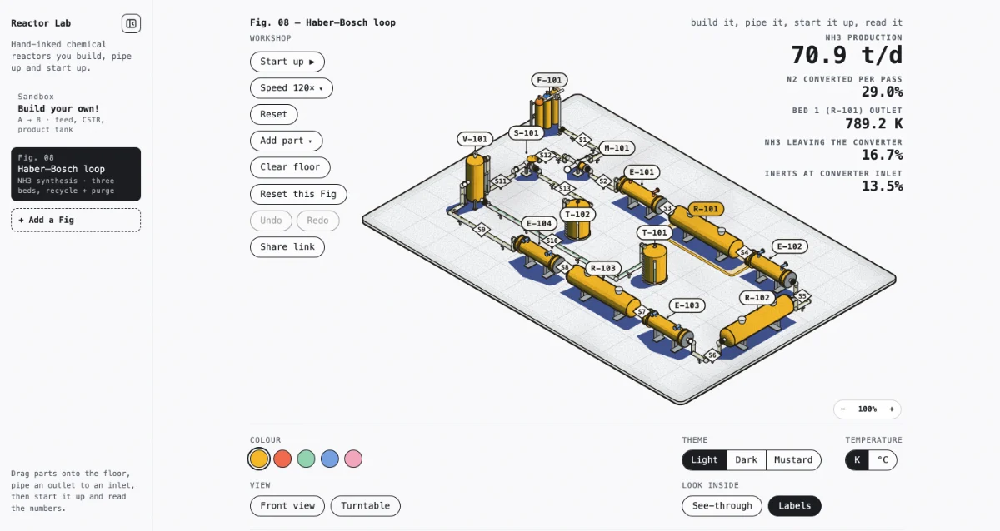

# Blog style guide — v0.3

The whole design in one sentence: **the blog is only its text** — pure white
paper, pure black ink, JetBrains Mono for every character, 1px rules as the
only structure, and one gesture (hover/selection inverts ink and paper).

Status: v0.3. Adjust this file whenever the style changes; every new post
must follow it. (v0.3, 2026-10-25: category line `about me · projects ·
writings`; projects get screenshots; papers live on `writings.html`;
contact is unlinked for now. v0.2: contact line under the name, bottom
category line + three standalone pages, unframed `pre.art`.)

## Site map

- `index.html` — the blog, and the main thing. Header stack: name (h1),
  category line `about me · projects · writings` (small), tagline. Then
  the post list. Footer: just the © line. The category line is the site's
  only navigation besides `← index`; the email lives on the contact page
  only.
- `about.html` — About Me: the bio, then the Minecraft picture underneath.
- `projects.html` — Projects: things built or being built, each with its
  title, a screenshot and a date line (see "Adding a project or a paper").
- `writings.html` — Writings: papers, newest first. Kept apart from blog
  posts, which stay on the home page.
- `contact.html` — just the email line and `discord: @unlikelihood`, right
  under the heading. Off the category line since 2026-10-25 ("delete the
  contact me part for now"); the page still exists, so adding the link back
  restores it.
- `posts/<slug>.html` — blog posts.
- `img/` — the few pictures the site uses, web-compressed (≤1200px WebP).

## Hard rules

1. **Two colors.** `#fff` paper, `#000` ink. Never a third. Grays included.
2. **One face.** JetBrains Mono (400, 700, + italics), loaded from Google
   Fonts. Fallbacks: `ui-monospace, "SF Mono", Menlo, Consolas, monospace`.
3. **HTML + CSS only.** No JavaScript, no build step, no framework, ever.
4. **1px rules only.** Borders on `pre`, `th`, `blockquote`, `hr`, `footer`
   are all 1px solid ink. Nothing thicker, nothing dashed, no shadows,
   no rounded corners, no backgrounds.
5. **No chrome.** No nav bar, cards, icons, buttons, or badges. Navigation
   is `← index` on subpages plus the header category line on the home page.
   Pictures are allowed where Shante asks: the about page's picture
   (``, unframed) and project screenshots (`.shot`, 1px ink
   frame), compressed into `img/`. Posts stay image-free unless Shante says
   otherwise.
6. All shared styling lives in `style.css`. Posts carry **zero** inline
   styles and no `<style>` blocks.

## Layout constants (from style.css)

| Thing | Value |
|---|---|
| Measure | `max-width: 66ch`, centered |
| Body type | 15px (`0.9375rem`), line-height 1.75 |
| Headings | h1 18px; h2/h3 16px; h3 italic; more space above than below |
| Code blocks | 14px, line-height 1.6, 1px border, `overflow-x: auto` |
| Page padding | `4.5rem 1.25rem 4rem` |

Posts usually start life as Obsidian notes — the export/convert process
lives in PUBLISHING.md.

## Writing a new post

1. Create `posts/<slug>.html` from this skeleton (fill in title,
   description, h1, and date):

   ```html
   <!DOCTYPE html>
   <html lang="en">
   <head>
     <meta charset="utf-8">
     <meta name="viewport" content="width=device-width, initial-scale=1">
     <title>Post title · Shante Zhou</title>
     <meta name="description" content="One honest sentence.">
     <link rel="preconnect" href="https://fonts.googleapis.com">
     <link rel="preconnect" href="https://fonts.gstatic.com" crossorigin>
     <link href="https://fonts.googleapis.com/css2?family=JetBrains+Mono:ital,wght@0,400;0,700;1,400;1,700&display=swap" rel="stylesheet">
     <link rel="stylesheet" href="../style.css">
   </head>
   <body>
     <nav class="site-nav"><a href="../index.html">← index</a></nav>
     <main>
     <article>
       <header>
         <h1>Post title</h1>
         <p class="meta"><time datetime="YYYY-MM-DD">YYYY-MM-DD</time></p>
       </header>

       <!-- content -->

     </article>
     </main>
     <footer><a href="../index.html">← index</a></footer>
   </body>
   </html>
   ```
3. Add one entry to the list in `index.html`, newest first (for the first
   post, uncomment the list first). Entries follow the
   Lilian-Weng-minus-the-box format: bold title, 1–2 line summary, date —
   separated by 1px rules, no cards:

   ```html
   <li>
     <a class="post-title" href="posts/<slug>.html">Post title</a>
     <p class="post-summary">One or two honest lines about the post.</p>
     <time datetime="YYYY-MM-DD">YYYY-MM-DD</time>
   </li>
   ```

## Adding a project or a paper

No summaries for now: a bold title, then small `.post-meta` lines.

- **Project** (`projects.html`, newest first) — the title links to the
  thing itself: the live app if there is one, else the repo. Then a
  screenshot, `img/<slug>.webp` at 1200px wide (from a light theme where
  the app has one), linked to the same place. Then the date, plus `code`
  when the title isn't the repo. Web apps (JavaScript allowed there) live
  in their own repo and deploy elsewhere (Reactor Lab: a private repo on
  Vercel, so no `code` link); this repo stays HTML + CSS.

  ```html
  <li>
    <a class="post-title" href="https://pocketreactors.vercel.app/">Reactor Lab</a>
    <a class="shot" href="https://pocketreactors.vercel.app/" tabindex="-1" aria-hidden="true"></a>
    <p class="post-meta"><time datetime="2026-10-23">2026-10-23</time></p>
  </li>
  ```

  The screenshot link is hidden from screen readers and from Tab (the
  title is the same link), which is why its `alt` is empty.
- **Paper** (`writings.html`, newest first) — the title links to the
  paper. One meta line for authors (my name in `<strong>`), venue or arXiv
  id and year; a second for `pdf · code` links.

  ```html
  <li>
    <a class="post-title" href="https://arxiv.org/abs/YYMM.NNNNN">Paper title</a>
    <p class="post-meta"><strong>S. Zhou</strong>, A. Coauthor · arXiv YYMM.NNNNN · <time datetime="YYYY">YYYY</time></p>
    <p class="post-meta"><a href="https://arxiv.org/pdf/YYMM.NNNNN">pdf</a> · <a href="https://github.com/shantezhou/repo">code</a></p>
  </li>
  ```

## Content elements

- **Math** — no MathJax. Use `<var>` for variables, `<sup>`/`<sub>` for
  indices, and Unicode operators (∇ η θ λ ≈ ‖…‖ Σ). Display equations go in
  `<p class="math">…</p>` (centered).
- **Code** — `<pre><code>…</code></pre>`. Escape `<`, `>`, `&`. No syntax
  highlighting; the border is the highlight.
- **ASCII diagrams** — a `<pre>` with `role="img"` and an `aria-label`
  describing what the picture shows. Keep every line ≤ 36 characters so the
  diagram fits a phone screen without scrolling. Charts/diagrams keep the
  1px frame; decorative art uses `<pre class="art">`
  — no frame, no padding.
- **Asides** — `<blockquote>` (renders italic with a 1px left rule). Real
  quotes get a real attribution; unattributed blockquotes read as asides.
- **Headings** — h2 for sections, h3 (italic) sparingly for sub-points.
  Sibling sections are both h2; don't demote for looks.
- **Tables** — plain `<table>`; only the header row is ruled. Keep them
  narrow enough for the 66ch measure.
- **Emphasis** — `<strong>` and `<em>` only. `<mark>` inverts to
  white-on-black; use it rarely.

## Voice

Technical, first-person, plain. Posts either teach something or record what
I'm learning — AI, chemistry, mathematics. Dates are ISO (`2026-08-22`).
Claims must be true; toy examples are fine when labeled as such.
